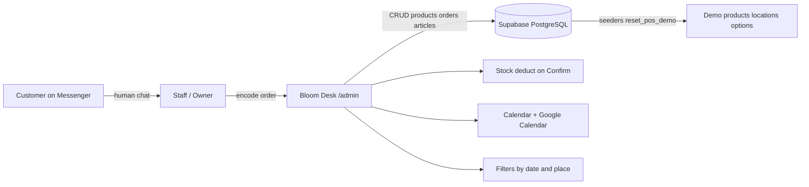

# Flower Shop POS + Messenger — Client Proposal (as built)

**Prepared by:** Salora Tech Solutions  
**Product name:** Bloom Desk (Track B Admin POS)  
**Date:** 2026-10-15 (updated to match live system)  
**Status:** Matches the deployed `/admin` POS + Supabase demo  

> **Supersedes** the older Word file `PROPOSE_SYSTEM_FLOWER SHOP (1).docx` (₱15,000 customer website with cart/checkout). That package is **not** what we built. See [website-scope-parked.md](./website-scope-parked.md).

---

## 1. What the shop gets

Customers keep ordering on **Facebook Messenger** (and walk-in / call). Staff encode every accepted order into **Bloom Desk** — a web admin POS on laptop and phone.

**Single source of truth (live database):**

| Area | What works in the system |
|------|---------------------------|
| Access | Admin login — `owner` / `staff` demo roles |
| Catalog | Products in **Supabase** — full CRUD (create / edit / restock / delete) |
| Demo data | SQL **seeders** (`reset_pos_demo`) — not a hardcoded React catalog |
| Orders | Create / edit: Messenger · walk-in · call; customer, date, pickup/delivery, location |
| Customization | Ribbon, wrapper, card message, add-ons, notes, change history |
| Status flow | Pending → Confirmed → Preparing → Ready / Out → Completed / Cancelled |
| Stock rules | Deduct on **Confirm**; restore on **Cancel**; sold out at zero |
| Calendar | Week view of scheduled orders + **Google Calendar** add link |
| Filters | Date, location, status, source |
| Pre-orders | Flag + supplier reminder checklist |
| Reference | Flower meanings / colors / tips (editable) |
| Dashboard | Today’s counts, sales snapshot, low stock, reminders |
| Devices | Mobile-friendly admin |

**Not included (Track A / separate quote):** Meta inbox automation, AI bot, customer shopping website, payment gateway, GPS riders, SMS blasts.

---

## 2. Architecture (as built)

- **Frontend:** Vite + React admin under `/admin`  
- **Backend:** Supabase (`pos_products`, `pos_orders`, `pos_articles`, `pos_locations`, `pos_options`)  
- **Demo reset:** Dashboard → Reset demo → RPC `reset_pos_demo()` reloads seed rows  

---

## 3. Track B vs Track A

| | **Track B — Manual POS** (this build) | **Track A — Meta + AI** (Phase 2) |
|---|---|---|
| Orders enter POS | Staff encodes from Messenger (~1 min) | Bot creates orders via Meta |
| One-time fee | **₱30,000** | **₱55,000–₱85,000** on top of B |
| Monthly | Hosting as agreed | Hosting + AI ~₱1,500–₱4,000/mo |
| Status | **Built and demoable** | Not built |

---

## 4. Screens delivered

1. Login  
2. Dashboard (today + reset demo)  
3. New Order / Order detail (status + customization + Google Calendar)  
4. Orders list + filters  
5. Calendar  
6. Inventory (product CRUD + stock)  
7. Pre-orders / reminders  
8. Flower reference  
9. Concepts gallery (presenter UI themes — internal walkthrough, not a customer storefront)

Shop locations and ribbon/wrapper options load from **database seeders**, same as products.

---

## 5. Payment terms (Track B)

| Milestone | Share | Amount |
|-----------|-------|--------|
| Upon project approval | 40% | ₱12,000 |
| Upon working system presentation | 40% | ₱12,000 |
| Upon final testing & turnover | 20% | ₱6,000 |
| **Total** | **100%** | **₱30,000** |

---

## 6. Demo setup (for presentation)

1. Supabase project with `supabase/bootstrap.sql` **or** existing project + `supabase/migrate_shop_options.sql`  
2. Env: `VITE_SUPABASE_URL` + `VITE_SUPABASE_ANON_KEY`  
3. Open `/admin` → login `owner` / `demo123`  
4. Confirm header shows **Data: Supabase**  
5. Optional: Dashboard → **Reset demo** to reseed products, sample orders, locations, options  

Without Supabase keys the app falls back to localStorage (offline only). Presentations should always use Supabase.

---

## 7. Explicitly out of this package

- Customer website, cart, checkout, customer accounts (old ₱15k Word proposal)  
- Auto-import / AI replies from Messenger inbox  
- Payment gateway, GPS tracking, BIR hardware POS, SMS/email marketing, multi-branch  

---

## 8. Next steps

1. Owner walks the live `/admin` demo on Supabase.  
2. Confirm Track B ₱30k (and whether Track A is of interest later).  
3. Replace seed catalog with the shop’s real products, prices, stock, and locations.  
4. Tighten RLS before production (current policies are demo-open).  
5. Revisit Track A after one busy season.
