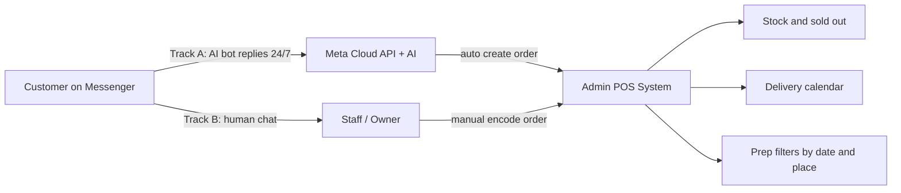

# Flower Shop POS + Messenger System — Client Proposal

**Prepared by:** Salora Tech Solutions  
**Project:** Flower Shop Management / POS (Admin-only)  
**Date:** 2026-10-15  
**Sources:** Meeting Summary (Rhea & Brian); prior website starter discussion  
**Status:** Ready for owner review  

---

## 1. Problem → Solution

### The problem

Orders arrive mainly through **Facebook Messenger**. Today those chats are not centrally recorded, stock is tracked manually, imported-flower pre-orders and supplier follow-ups get forgotten, and peak days (Valentine’s, Mother’s Day) make it hard to organize pickups and deliveries by date and location. Special requests (ribbon, wrapper, card message) are easy to miss when they live only in chat history.

### The solution

Keep **Messenger as the customer ordering channel**. Build an **admin-only POS / operations desk** as the single source of truth for:

- Orders (including those that started on Messenger)
- Stock and sold-out status
- Pickup / delivery calendar
- Customization details
- Pre-order / supplier reminders
- Flower meaning reference for staff

**There is no customer shopping website in this package.** Customers continue to message the shop as they already do.

---

## 2. Two tracks (choose how Messenger connects to POS)

| | **Track B — Manual POS** (recommended launch) | **Track A — Meta + AI automation** (Phase 2) |
|---|---|---|
| **How orders enter POS** | Staff accepts Messenger chat, then encodes order in POS (~1 minute) | AI replies on Messenger 24/7, collects details, creates order in POS |
| **Customer experience** | Same as today (human chat) | Instant bot replies; handoff to human for custom / unclear cases |
| **One-time fee** | **₱30,000** | **₱55,000–₱85,000** on top of Track B |
| **Monthly** | Hosting only (small / included in handoff terms as agreed) | Hosting + AI usage estimate **₱1,500–₱4,000/mo** (volume-dependent) |
| **Dependencies** | Product list, stock starting numbers, delivery areas | Facebook Page admin access, Meta App Review, AI provider |
| **Go-live risk** | Low | Higher (Meta review delay, bot mistakes, peak AI cost) |

### Recommendation

**Start with Track B.** Offer Track A after the shop has used the POS through at least one busy season.

> You asked for many features and also an affordable price. The practical path is a shop POS first — Messenger stays your ordering channel, but nothing gets lost, stock does not get overbooked, and peak-day deliveries are filterable by date and place. Full AI Messenger automation is possible with Meta, but it is a **second product** with Meta approval and monthly AI cost — not something that fits a ₱15,000 website package.

---

## 3. Track B — Manual Messenger + POS (₱30,000)

### Story

Customers still order on Messenger. Staff confirms the request in chat, then records it in the POS. The POS becomes the single place for stock, schedule, and preparation — not Facebook’s inbox.

### Included features

| Area | What you get |
|------|----------------|
| Access | Admin / staff login (owner + staff roles) |
| Catalog | Products, categories, stock quantity, Sold Out when zero |
| Orders | Create / edit: customer, recipient, date, pickup or delivery, location |
| Customization | Ribbon, wrapper, card message, add-ons, notes, change history, cancellation |
| Status flow | Pending → Confirmed → Preparing → Ready / Out for Delivery → Completed / Cancelled |
| Stock rules | Deduct on **Confirm**; restock when supplies arrive |
| Calendar | Confirmed pickup / delivery dates on a shop calendar |
| Filters | By date, location, and status (peak-day prep) |
| Pre-orders | Flag imported / special flowers; simple supplier reminder list (due dates / checklist) |
| Reference | Flower meanings & color guide for staff |
| Dashboard | Today’s order counts / basic sales snapshot |
| Devices | Mobile-friendly admin (usable on phone in the shop) |
| Handoff | Basic testing, deployment, short orientation |

### Payment terms (Track B)

| Milestone | Share | Amount |
|-----------|-------|--------|
| Upon project approval | 40% | ₱12,000 |
| Upon working system presentation | 40% | ₱12,000 |
| Upon final testing & turnover | 20% | ₱6,000 |
| **Total** | **100%** | **₱30,000** |

### Timeline (Track B)

**About 3–4 weeks** after content and approvals are ready (product list, starting stock, locations, sample flower-meaning content).

### Important scope condition (Messenger)

Facebook / Messenger orders are **entered manually** into the POS in Track B. Automatically reading the Page inbox requires Meta permissions and is **Track A**, not included in ₱30,000.

---

## 4. Track A — Meta Messenger + AI (Phase 2 premium)

### Story

An AI assistant replies on the Facebook Page Messenger 24/7, answers common questions (including flower meanings), collects order details, and writes confirmed orders into the **same POS database**. Staff monitors exceptions and takes over for custom designs.

### Extra build (on top of Track B)

- Meta Developer App, Page connection, webhooks, Messenger permissions  
- Conversation / AI agent for order intake + FAQ  
- Human handoff when the bot is unsure or the order is highly custom  
- Auto order create in POS + optional confirmation reply in Messenger  
- Audit log (bot vs staff)  
- Monitoring and usage controls for AI cost  

### Pricing (Track A)

| Item | Estimate |
|------|----------|
| One-time automation layer | **₱55,000–₱85,000** (after Track B exists) |
| Monthly hosting + AI usage | **₱1,500–₱4,000** (depends on chat volume) |

### Risks (say clearly to owner)

- Meta App Review can delay go-live  
- AI can misquote availability or price — staff override rules required  
- Peak season = higher AI/API cost  
- Wrong bot answers hurt trust (flowers are emotional purchases)  

### Timeline (Track A)

**About +3–5 weeks** after Track B is live **and** Facebook Page admin access + Meta approval are available.

---

## 5. Feature checklist vs meeting requirements

Full Include / Later / Out-of-scope matrix: [scope-matrix.md](./scope-matrix.md)

Summary for Track B:

| Meeting need | Track B |
|--------------|---------|
| Centralized order management (incl. Messenger-origin orders) | Included (manual encode) |
| Automatic stock & sold-out | Included |
| Pre-order + supplier reminders | Included (in-app reminders; not SMS) |
| Calendar for pickup / delivery | Included |
| Filter by date & location | Included |
| Flower meanings reference | Included |
| Customization & order changes | Included |
| Affordable essentials-first | Included at ₱30,000 |
| Auto-import / AI from Messenger | **Track A only** |

---

## 6. Manual vs automated (by track)

| Step | Track B | Track A |
|------|---------|---------|
| Customer messages shop | Human replies on Messenger | AI replies 24/7 (handoff if needed) |
| Collect bouquet details | Human in chat | AI guided questions |
| Check stock before accept | Staff checks POS while chatting | Bot reads availability from POS |
| Save order | Staff encodes in POS | Bot writes to POS |
| Confirm → deduct stock | POS rule | Same POS rule |
| Prep by date / place | POS calendar + filters | Same |
| Custom ribbon / card changes | Staff updates order in POS | Staff or bot update; custom often human |

---

## 7. Explicitly out of Track B (protect scope)

- Customer-facing website, cart, checkout, customer accounts (old ₱15k website idea)  
- Design theme packs / public storefront demos as a client deliverable  
- Payment gateway (PayMongo / Maya Checkout / Stripe)  
- GPS rider tracking  
- BIR-certified hardware POS / cash drawer (unless separately quoted)  
- SMS / email marketing blasts  
- Multi-branch  
- Fully autonomous AI with no staff review on custom bouquets  

If the owner requires a **₱15,000** hard ceiling: only a cut-down MVP (orders + basic stock + statuses) is possible, and calendar / pre-order reminders / flower encyclopedia / Meta are cut. That under-delivers the meeting list — **₱30,000 Track B is the recommended package.**

---

## 8. Assumptions

1. Customers continue ordering primarily via Messenger (and walk-in / call as today).  
2. Owner provides product names, prices, starting stock, delivery / pickup locations, and shop hours.  
3. “POS” in this proposal means a **web admin system** usable on laptop and phone — not BIR hardware certification unless quoted separately.  
4. Track A requires Facebook Page ownership/admin and acceptance of monthly AI/hosting cost.  
5. Content for flower meanings can start from a standard set and be edited by the shop.

---

## 9. Owner alignment (before kickoff)

Use the checklist: [owner-alignment-checklist.md](./owner-alignment-checklist.md)

Must confirm:

1. Budget: **₱30,000 Track B** (recommended) vs ₱15,000 cut-down  
2. POS = web admin on laptop/phone (not hardware BIR POS)  
3. AI Messenger = launch-critical vs Phase 2  
4. If Track A: Page admin access + monthly fee willingness  

---

## 10. Relation to existing demo work

The Bloom & Co. / 10-concept **customer website demo** in this repository is **not** the deliverable for this client package. It may be reused only as an internal UI shell for admin screens if useful. See [website-scope-parked.md](./website-scope-parked.md).

---

## 11. Next steps

1. Owner reviews this proposal and completes the alignment checklist.  
2. Salora confirms Track B (and optional Track A interest).  
3. Collect products, stock, locations, and branding for admin.  
4. Kick off Track B build (~3–4 weeks).  
5. Revisit Track A after first peak season or if budget allows earlier.
